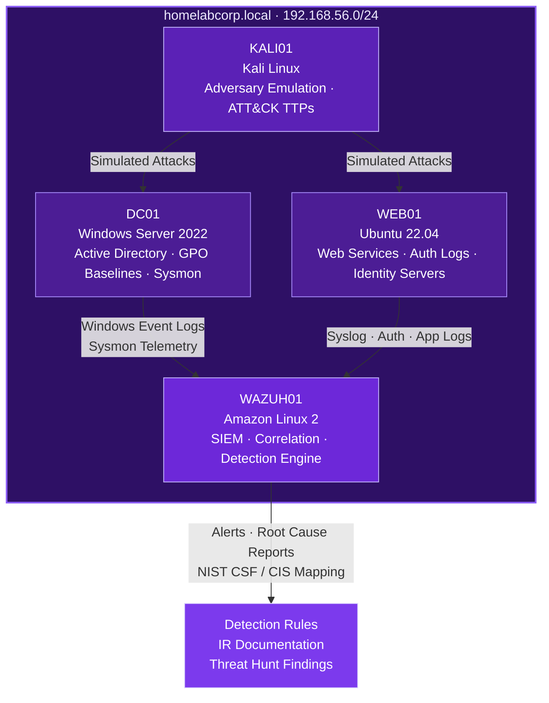

<div align="center">


<a href="https://raghv.dev">
  
</a>

<br/>


<br/><br/>

<a href="https://raghv.dev"></a>
<a href="https://www.linkedin.com/in/raghav-mahajan-17611b24b"></a>
<a href="mailto:raaghvv0508@gmail.com"></a>
<a href="https://github.com/raghv-m"></a>
<a href="https://discord.gg/WSPYmGp3nN"></a>

<br/><br/>


</div>

---

## About

I build detection systems, run threat hunts, and harden infrastructure. My work sits at the intersection of **security operations** and **software engineering** — I don't just read alerts, I write the rules that generate them, automate the response around them, and document the root cause afterward.

Day to day I operate a full-stack **SIEM + Active Directory lab** where I simulate adversary behaviour, tune detections against real telemetry, and close the gaps I find. Everything is mapped to **NIST CSF** and **CIS Controls** so the work translates directly to enterprise environments.

Alongside security, I ship production software — Next.js applications with real auth, rate limiting, and a defensible threat model. That engineering background is what lets me automate SOC workflows instead of clicking through them.

I founded and run the **Edmonton Cybersecurity Community** on Discord, and publish **Raghav's Cyber Daily** on LinkedIn — threat intel breakdowns with Sigma, Splunk, Sentinel KQL, Wazuh, and YARA detection logic in every edition.

<div align="center">

### Open To


</div>

---

## Tech Arsenal

<div align="center">

**Operating Systems & Infrastructure**


**Languages & Automation**


**Security Platforms**


**Offensive & Analysis Tooling**


**Identity, Cloud & Engineering**


<br/>


</div>

---

## Security Domain Expertise

| Domain | Proficiency | Details |
|---|---|---|
| **SIEM Operations** | ██████████ Advanced | Wazuh v4.9 single-node + agent fleet, Splunk search & correlation, log pipeline design, index tuning, false-positive reduction |
| **Detection Engineering** | █████████░ Advanced | Custom Wazuh decoders and rules for distributed brute force, low-and-slow attacks, lateral movement; Sigma authoring; KQL for Sentinel |
| **Incident Response** | █████████░ Advanced | Full IR lifecycle simulations — detection, triage, containment, eradication, recovery, formal root-cause reporting |
| **Active Directory Security** | ████████░░ Proficient | Windows Server 2022 domain design, GPO hardening baselines, Kerberos attack paths, privilege-escalation detection |
| **Threat Hunting** | ████████░░ Proficient | Hypothesis-driven hunts, ATT&CK-mapped coverage analysis, detection-gap identification and closure |
| **Network Security** | ████████░░ Proficient | Segmentation design, packet analysis, IDS tuning, zero-trust architecture principles |
| **Identity & Access** | ███████░░░ Proficient | Keycloak, Duende IdentityServer, FusionAuth deployments; OIDC/OAuth2 flows, SSO, MFA enforcement |
| **Security Automation** | ███████░░░ Proficient | Bash and Python IR tooling, PowerShell forensics collection, SOAR playbook design |
| **Application Security** | ███████░░░ Proficient | Production hardening — auth flows, rate limiting, input validation, secure headers, dependency and secret management |
| **Cloud Security** | ██████░░░░ Developing | Azure and Entra ID posture, cloud log ingestion into SIEM, SC-200 track in progress |

---

## HomeLab Architecture

<div align="center">

**`homelabcorp.local`** — a production-shaped detection lab, not a tutorial screenshot

</div>



<div align="center">


<a href="https://github.com/HomeLab-Raghav"></a>

</div>

---

## Featured Work

<details>
<summary><b>🛡️ &nbsp; HomeLab Corp — SIEM &amp; Active Directory Detection Lab</b></summary>

<br/>

A full-stack enterprise simulation environment built for incident response practice, detection tuning, and threat hunting. Four-node topology with a Windows Server 2022 domain controller, hardened GPO baselines, a Linux web tier, an offensive workstation, and a Wazuh SIEM aggregating telemetry from every host.

| | |
|---|---|
| **Stack** | Wazuh 4.9, Splunk, Windows Server 2022, Ubuntu 22.04, Kali Linux, Sysmon, VirtualBox |
| **Scale** | 4-node domain, 50+ documented attack simulations, continuous log ingestion |
| **Detection** | Custom decoders and rules for distributed brute force, low-and-slow credential attacks, lateral movement, persistence |
| **Security** | GPO hardening baselines, least-privilege AD design, segmented lab network |
| **Impact** | Every simulation mapped to NIST CSF and CIS Controls with formal root-cause documentation |
| **Repository** | [HomeLab-Raghav](https://github.com/HomeLab-Raghav) |

The lab is deliberately noisy — real services generating real logs — so detections are tuned against genuine baseline behaviour rather than clean synthetic data. Lab 02 walks the complete IR cycle end to end: detection, containment, eradication, recovery, and post-incident review.

</details>

<details>
<summary><b>🐳 &nbsp; docker-soc-lab — Containerized Wazuh SOC Environment</b></summary>

<br/>

A reproducible, single-command SOC lab that spins up a Wazuh manager, indexer, and dashboard alongside instrumented agents — designed so anyone can clone it and be generating detections in minutes instead of hours.

| | |
|---|---|
| **Stack** | Docker Compose, Wazuh v4.9.0 single-node, Ubuntu 22.04 agent, Filebeat, OpenSearch |
| **Scale** | Full SIEM stack containerized; portable across any Docker host |
| **Performance** | Cold start to live alert pipeline in minutes; volume-persisted indices |
| **Security** | Isolated bridge networking, credential separation, hardened agent enrollment |
| **Impact** | Removes the biggest barrier to entry for blue-teamers learning SIEM operations |
| **Repository** | [docker-soc-lab](https://github.com/HomeLab-Raghav) |

</details>

<details>
<summary><b>🔑 &nbsp; Identity &amp; Access Management Lab</b></summary>

<br/>

Three competing identity providers deployed side by side to compare OIDC and OAuth2 implementations, token lifecycles, and the attack surface each one exposes.

| | |
|---|---|
| **Stack** | Keycloak, Duende IdentityServer, FusionAuth, PostgreSQL, Docker |
| **Scale** | Three IdPs, federated test realms, multiple client application types |
| **Security** | MFA enforcement, token replay analysis, scope and consent misconfiguration testing, brute-force lockout policy |
| **Detection** | Authentication failure correlation and impossible-travel style logic piped into the SIEM |
| **Impact** | Practical grounding in the identity attacks that dominate real breach reports |
| **Repository** | [HomeLab-Raghav](https://github.com/HomeLab-Raghav) |

</details>

<details>
<summary><b>🌐 &nbsp; raghv.dev — Production Portfolio Platform</b></summary>

<br/>

A full-stack Next.js application with an authenticated admin panel, MDX blog engine, contact pipeline, and a complete newsletter system — built and hardened to production standards rather than demo standards.

| | |
|---|---|
| **Stack** | Next.js 16 (App Router, Turbopack), React 19, TypeScript, Prisma 7, LibSQL/Turso, NextAuth v4, Tailwind |
| **Scale** | Admin CMS, MDX blog, subscriber list with welcome and new-post automation |
| **Performance** | Edge-deployed on Vercel with server components and streaming rendering |
| **Security** | Credential auth with hashed secrets, Upstash rate limiting, Zod validation on every boundary, secure headers, secret hygiene |
| **Impact** | Live production surface I actively threat-model, audit, and remediate against |
| **Repository** | [raghv-portfolio](https://github.com/raghv-m/raghv-portfolio) · [Live](https://raghv.dev) |

</details>

<details>
<summary><b>📊 &nbsp; Fleet Rental Data Validation Pipeline</b></summary>

<br/>

An analytics engineering pipeline that ingests messy fleet rental data, validates it against contract rules, and surfaces anomalies through a layered warehouse model.

| | |
|---|---|
| **Stack** | Python, pandas, PostgreSQL (Docker), dbt-core |
| **Scale** | Staging → intermediate → mart layered transformation architecture |
| **Performance** | Idempotent incremental runs with tested model contracts |
| **Security** | Containerized credential isolation, no secrets in version control |
| **Impact** | Automated data-quality checks that catch integrity failures before they reach reporting |
| **Repository** | [raghv-m](https://github.com/raghv-m) |

</details>

<details>
<summary><b>🎓 &nbsp; ImmigrateX — NAIT Capstone</b></summary>

<br/>

An immigration pathway assessment platform that evaluates user profiles against program eligibility criteria and returns ranked, explainable recommendations.

| | |
|---|---|
| **Stack** | Full-stack web application, relational data model, rules-based scoring engine |
| **Scale** | Multi-program eligibility matrix with weighted criteria |
| **Security** | Sensitive personal data handled with validation, access control, and minimal retention |
| **Impact** | Capstone deliverable for the NAIT Computer Software Engineering diploma |
| **Repository** | [raghv-m](https://github.com/raghv-m) |

</details>

<details>
<summary><b>💬 &nbsp; Chattr &amp; 3D Chess — Engineering Sandbox</b></summary>

<br/>

Two projects that stretched different muscles: a real-time messaging application with live presence and delivery state, and a fully interactive 3D chess engine rendered in the browser.

| | |
|---|---|
| **Stack** | WebSockets, Node.js, React, Three.js, WebGL |
| **Scale** | Real-time multi-user messaging; full legal-move chess engine with 3D board |
| **Performance** | Sub-second message delivery; 60fps rendering with optimized scene graph |
| **Security** | Authenticated sessions, server-side move validation, sanitized message payloads |
| **Impact** | Proof that the security work rests on genuine software engineering fundamentals |
| **Repository** | [raghv-m](https://github.com/raghv-m) |

</details>

---

## Experience

### Tactical Guard / Screening Officer — Impact Security Group
`May 2023 — Present` · Edmonton, AB

Deployed to Covenant Health and ADESA sites, operating access control and screening under formal security protocol in high-accountability environments.

- Enforce site access control, screening procedures, and incident escalation chains
- Produce detailed written incident documentation — the same discipline applied to IR reporting
- Operate surveillance and monitoring systems with continuous situational assessment
- Coordinate directly with site stakeholders during live incidents

   

<br/>

### Loss Prevention Officer — Dollarama
`Edmonton, AB`

Physical security and loss prevention operations — surveillance, pattern recognition, and evidence-grade incident reporting.

- Identify behavioural anomalies against baseline patterns — the physical analogue of threat hunting
- Maintain evidence chains and file reports that withstand review
- Apply de-escalation and controlled response under pressure

  

<br/>

### Freelance Web &amp; Software Developer
`Independent` · Edmonton, AB

End-to-end delivery of production web applications for real clients — architecture, implementation, deployment, and ongoing security maintenance.

- Ship full-stack applications on Next.js, React, TypeScript, and PostgreSQL
- Implement authentication, rate limiting, and input validation as baseline requirements
- Own deployment pipelines, monitoring, and post-launch hardening

  

<br/>

### Diploma, Computer Software Engineering — NAIT
`2022 — 2024` · Digital Media &amp; IT · Edmonton, AB

---

## Achievements

<div align="center">

| Recognition | Details |
|---|---|
| **CompTIA Security+ — 860/900** | Passed SY0-701 well above the 750 cut score on first attempt |
| **50+ Documented Attack Simulations** | Full lab portfolio mapped to NIST CSF and CIS Controls with root-cause reporting |
| **Founder — Edmonton Cybersecurity Community** | Built and moderate a regional Discord community for Alberta security practitioners |
| **Author — Raghav's Cyber Daily** | Recurring LinkedIn newsletter with Sigma, Splunk, KQL, Wazuh, and YARA detection logic per story |
| **Custom Wazuh Detection Ruleset** | Original rules covering distributed brute force, low-and-slow attacks, and lateral movement |
| **Full IR Cycle Simulation** | End-to-end detection → containment → eradication → recovery workflow, formally documented |
| **NAIT Capstone — ImmigrateX** | Immigration pathway assessment platform delivered as diploma capstone |
| **Production Security Audit** | Self-directed defensive audit and remediation runbook for a live production application |

</div>

---

## Certifications

<div align="center">

**CompTIA**


**ISC2**


**Microsoft**


**Google**


**Offensive Security**


</div>

---

## Hands-On Profiles

<div align="center">

<a href="https://tryhackme.com"></a>
<a href="https://www.hackthebox.com"></a>
<a href="https://letsdefend.io"></a>
<a href="https://app.cyberdefenders.org"></a>
<a href="https://github.com/raghv-m"></a>

</div>

---

## GitHub Analytics

<div align="center">


<br/>


</div>

---

## Trophy Case

<div align="center">


</div>

---

## Contribution Activity

<div align="center">


</div>

---

## Contribution Snake

<div align="center">

<picture>
  <source media="(prefers-color-scheme: dark)" srcset="https://raw.githubusercontent.com/raghv-m/raghv-m/output/github-contribution-grid-snake-dark.svg" />
  <source media="(prefers-color-scheme: light)" srcset="https://raw.githubusercontent.com/raghv-m/raghv-m/output/github-contribution-grid-snake.svg" />
  
</picture>

</div>

---

## Current Focus

```yaml
analyst:
  name: Raghav Mahajan
  role: Cybersecurity Analyst
  location: Edmonton, Alberta, Canada
  timezone: America/Edmonton

learning:
  - CompTIA CySA+ - advanced threat analysis & vulnerability management
  - Microsoft SC-200 - Sentinel, Defender XDR, KQL hunting
  - Active Directory & Entra ID attack paths and detection coverage
  - Velociraptor - endpoint forensics and live response

building:
  - HomeLab Labs 08-11 - advanced detection and hunt scenarios
  - Custom threat intelligence enrichment pipeline
  - SOAR playbooks for automated triage and containment
  - Python + Bash tooling for incident response workflows

exploring:
  - Zero-trust network segmentation architecture
  - Detection-as-code with Sigma and CI validation
  - Malware analysis fundamentals and YARA authoring

writing:
  - "Raghav's Cyber Daily" - LinkedIn threat intel newsletter
  - Root cause analysis reports from lab incident simulations

community:
  - Founder, Edmonton Cybersecurity Community (Discord)

open_to:
  - SOC Analyst (Tier 1 / Tier 2)
  - Detection Engineering
  - Incident Response
  - Junior Network Security Analyst
  - Security Engineering

long_term:
  - OSCP
  - Senior Analyst -> Security Engineer
```

---

## Connect

<div align="center">

<a href="mailto:raaghvv0508@gmail.com"></a>
<a href="https://www.linkedin.com/in/raghav-mahajan-17611b24b"></a>
<a href="https://github.com/raghv-m"></a>
<a href="https://raghv.dev"></a>
<a href="https://discord.gg/WSPYmGp3nN"></a>

<br/><br/>

**Into cybersecurity?** Join the Discord. &nbsp;·&nbsp; **Want to collab on lab work?** Always open. &nbsp;·&nbsp; **Hiring?** Let's talk.

</div>

---

<div align="center">

### *"Detection is a discipline, not a dashboard."*


</div>
