<picture><source media="(prefers-color-scheme: dark)" srcset="assets/header-nait-dark.svg"><source media="(prefers-color-scheme: light)" srcset="assets/header-nait-light.svg"></picture>

Hey, I'm Raghav. I studied Computer Software Engineering (Digital Media and IT) at NAIT in Edmonton, and I work in security: days on site as a corporate security supervisor, and the rest of my time in a home SOC lab, running attacks against my own network so I can practise catching them. I hold CompTIA Security+ and ISC2 CC, and I write the Blue Team Brief, a weekly plain-language security newsletter on LinkedIn.

 

<picture><source media="(prefers-color-scheme: dark)" srcset="assets/sec1-dark.svg"><source media="(prefers-color-scheme: light)" srcset="assets/sec1-light.svg">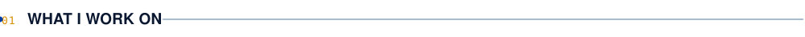</picture>

<picture><source media="(prefers-color-scheme: dark)" srcset="assets/focus-dark.svg"><source media="(prefers-color-scheme: light)" srcset="assets/focus-light.svg"></picture>

 

<picture><source media="(prefers-color-scheme: dark)" srcset="assets/sec2-dark.svg"><source media="(prefers-color-scheme: light)" srcset="assets/sec2-light.svg">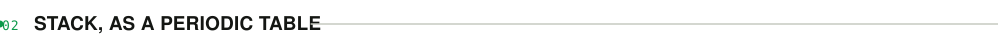</picture>

<picture><source media="(prefers-color-scheme: dark)" srcset="assets/stack-dark.svg"><source media="(prefers-color-scheme: light)" srcset="assets/stack-light.svg"></picture>

 

<picture><source media="(prefers-color-scheme: dark)" srcset="assets/sec3-dark.svg"><source media="(prefers-color-scheme: light)" srcset="assets/sec3-light.svg">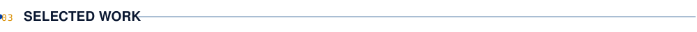</picture>

<a href="https://github.com/HomeLab-Raghav/docker-soc-lab"><picture><source media="(prefers-color-scheme: dark)" srcset="assets/soclab-dark.svg"><source media="(prefers-color-scheme: light)" srcset="assets/soclab-light.svg">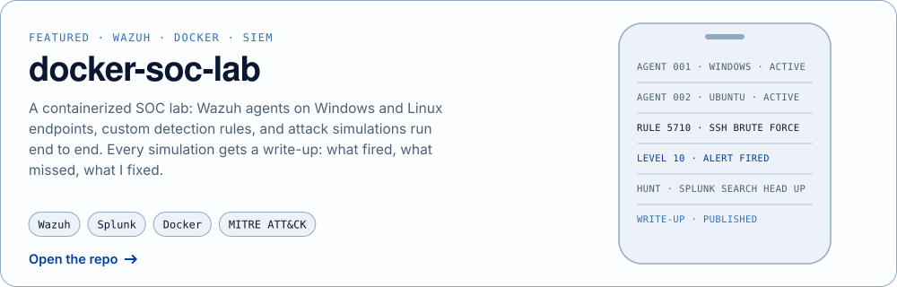</picture></a>

<a href="https://github.com/HomeLab-Raghav/SOC"><picture><source media="(prefers-color-scheme: dark)" srcset="assets/playbooks-dark.svg"><source media="(prefers-color-scheme: light)" srcset="assets/playbooks-light.svg">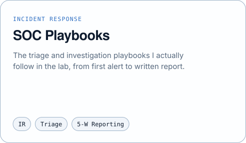</picture></a>
<a href="https://github.com/HomeLab-Raghav/HomeLab"><picture><source media="(prefers-color-scheme: dark)" srcset="assets/homelab-dark.svg"><source media="(prefers-color-scheme: light)" srcset="assets/homelab-light.svg">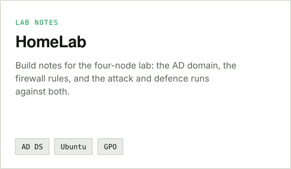</picture></a>

Most of my code is public here because the lab is the portfolio. Happy to walk through any of it on a call.

  

<picture><source media="(prefers-color-scheme: dark)" srcset="assets/sec4-dark.svg"><source media="(prefers-color-scheme: light)" srcset="assets/sec4-light.svg">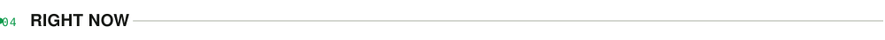</picture>

<picture><source media="(prefers-color-scheme: dark)" srcset="assets/now-dark.svg"><source media="(prefers-color-scheme: light)" srcset="assets/now-light.svg">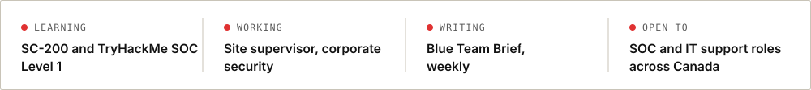</picture>

 

<picture><source media="(prefers-color-scheme: dark)" srcset="assets/sec5-dark.svg"><source media="(prefers-color-scheme: light)" srcset="assets/sec5-light.svg"></picture>

<picture><source media="(prefers-color-scheme: dark)" srcset="assets/contrib-dark.svg"><source media="(prefers-color-scheme: light)" srcset="assets/contrib-light.svg">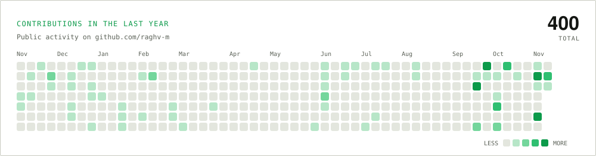</picture>

 

<a href="mailto:hello@raghv.dev"><picture><source media="(prefers-color-scheme: dark)" srcset="assets/footer-dark.svg"><source media="(prefers-color-scheme: light)" srcset="assets/footer-light.svg">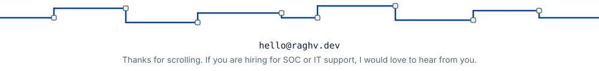</picture></a>

