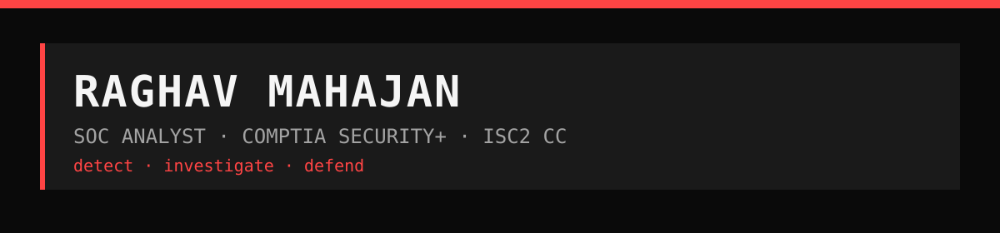

# Hey, I'm Raghav

I studied Computer Software Engineering (Digital Media and IT) at NAIT in Edmonton, and I work in security. By day I am a corporate security site supervisor. The rest of the time I run a SOC lab out of my home: four machines, a Windows domain, Wazuh and Splunk watching all of it, and a queue of attack simulations I run against my own network so I can practise catching them.

I hold CompTIA Security+ and ISC2 CC, and I am working through the Microsoft SC-200 and the TryHackMe SOC Level 1 path. Most of what I learn ends up written down: incident write-ups, the SPL queries I actually use, and a weekly LinkedIn newsletter called Blue Team Brief that turns security advisories into plain language.

Most of my code is public here because the lab is the portfolio. The repos below are the real working files, detections, playbooks, and notes included. Happy to walk through any of it on a call.

I am open to SOC analyst and IT support roles across Canada.

