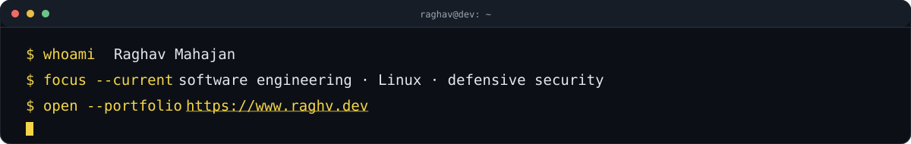
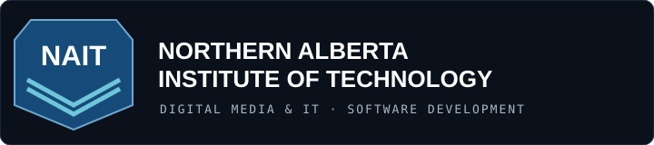
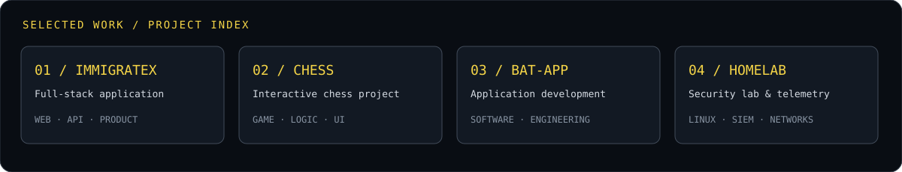

 

<a href="https://www.raghv.dev"><strong>↗ OPEN RAGHV.DEV</strong></a>
&nbsp;·&nbsp;
<a href="https://github.com/raghv-m?tab=repositories">REPOSITORIES</a>
&nbsp;·&nbsp;
<a href="https://github.com/raghv-m">GITHUB</a>

---

  

## `01 / PROFILE`

I'm Raghav Mahajan, a developer based in Edmonton, Alberta. I build web and mobile applications, work across frontend and backend systems, and spend time understanding how infrastructure behaves and how it can be secured.

My interests sit at the intersection of **software development, systems, and defensive cybersecurity**.

## `02 / EDUCATION`

  

**Northern Alberta Institute of Technology (NAIT)**  
Diploma in Digital Media & IT — Software Development concentration  
Edmonton, Alberta · 2024

## `03 / WHAT I'M WORKING WITH`

| Software engineering | Security & infrastructure |
|---|---|
| JavaScript / TypeScript | Linux |
| React / Node.js / Express | SIEM fundamentals |
| Flutter / Dart | Wazuh |
| MongoDB / Firebase / SQL | Splunk |
| REST APIs / Git / CI/CD | Wireshark / tcpdump |
| Python / Java / C# | Network monitoring & log analysis |

## `04 / SELECTED WORK`

  

Explore the repositories for source code, implementation details, and current project status. Project demos and write-ups are collected on **[raghv.dev](https://www.raghv.dev)**.

## `05 / SECURITY HOMELAB`

I use a virtual lab to practise defensive security workflows and understand how telemetry moves from endpoints and networks into monitoring tools.

- Linux administration and command-line investigation
- Wazuh, Splunk and log collection
- Network inspection with Wireshark and tcpdump
- Alert triage, detection logic and incident-response fundamentals

## `06 / GITHUB ACTIVITY`

  
  

  

## `07 / ELSEWHERE`

**[RAGHV.DEV](https://www.raghv.dev)** — Portfolio, projects & contact  
**[GITHUB](https://github.com/raghv-m)** — Code and experiments

  BUILD · BREAK · UNDERSTAND · IMPROVE
   
  

